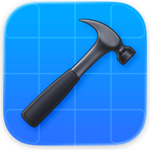

<h3 align="left">Hey What's up?</h3>

My name is Nathaporn Saituptim and I'm a Student Developer and Robotics innovator from Thailand

 <b>Founder & CEO of <a href="https://deeper.in.th">DeePer</a></b> — a free web app of deep conversation cards for couples, friends & family. 1,050+ curated questions, swipe and take turns answering on one phone. Try it at <a href="https://deeper.in.th">deeper.in.th</a>  <b>Working at Yeah Association </b> 

A high school student and developer driven by a passion for exploring the intersection of Artificial Intelligence, Computer Vision, and Robotics. I love building end-to-end innovations that bridge smart software with physical hardware, turning complex engineering ideas into functional, beautiful products.  - I’m currently building <a href="https://deeper.in.th">DeePer</a> as CEO, alongside autonomous systems, full-stack web applications, and embedded IoT solutions. - Continually expanding my knowledge in advanced machine learning applications and next-gen web frameworks. - Feel free to reach out if you want to talk about AI models, robotics development, startups, or slick UI design. - Fun fact: I have a huge appreciation for Apple-style minimalist layouts and dark-themed developer setups.

<h3 align="left">AI & Software Innovation</h3>

- AI & Robotics Hackathon 2025 By MIT Media Lab – Top 3 Global Finalist. - Play to Build AI Hackathon SEABW 2026 By AWS – Top 4 Finalist | Only solo student vs. Pro teams. - CEDT INNOVATION SUMMIT 2026 - Semifinal Round | Selected from 484 teams. - AI for Thai Service Onboarding - Won the AI for Thai Service Standard Award and made it to the Top 15 (out of 150 teams). - GLO Innovation 2026 - 1st Place Winner | Selected from 173 teams.  - OIC InsurTech Award 2026 - Top 5 Finalist | Selected from 501 teams.  - KMITL ToBeIT'69 – Top Best App Design for Elderly & Alzheimer’s Patients.

<h3 align="left">Robotics & Hardware</h3>

- World Robot Championship 2026 (3kg RC Sumo) – Top 2 Finalists & Dubai Global Finals Qualifier. - Maker Robotics Challenge 2026 (1.5kg Sumo) – Top 3 Finalists & China Finals Qualifier.

<h3 align="left">Web Development & Content</h3>

- Junior Webmaster Camp 14 – Overall Winner, Best Idea, and Best Content. - Thailand Metaverse Hackathon and Exhibition 2026 By Chulalongkorn University – Top 1st Place Winner.

<h2 align="left">Languages</h2>

                              

<h2 align="left">Web & Mobile</h2>

              

<h2 align="left">Backend & Database</h2>

                    

<h2 align="left">AI & Computer Vision</h2>

                    

<h2 align="left">Robotics, Hardware & IoT</h2>

                  

<h2 align="left">Cloud & DevOps</h2>

                      

<h2 align="left">Developer Tools</h2>

                          

 
