  <picture>
    <source media="(max-width: 700px)" srcset="https://raw.githubusercontent.com/Pug-03/Pug-03/main/assets/m/banner.svg" />
    
  </picture>

  <a href="https://deeper.in.th">
  <picture>
    <source media="(max-width: 700px)" srcset="https://raw.githubusercontent.com/Pug-03/Pug-03/main/assets/m/about.svg" />
    
  </picture>
  </a>

  <picture>
    <source media="(max-width: 700px)" srcset="https://raw.githubusercontent.com/Pug-03/Pug-03/main/assets/m/awards.svg" />
    
  </picture>

  <picture>
    <source media="(max-width: 700px)" srcset="https://raw.githubusercontent.com/Pug-03/Pug-03/main/assets/m/projects.svg" />
    
  </picture>

<a href="https://github.com/Pug-03/DeePer"><b>DeePer</b></a> &#183; <a href="https://github.com/Pug-03/Walk_We"><b>Walk We</b></a> &#183; <a href="https://github.com/Pug-03/Roo_mue_"><b>Roo Mue</b></a> &#183; <a href="https://github.com/Pug-03/PushPug"><b>PushPug</b></a>

  <picture>
    <source media="(max-width: 700px)" srcset="https://raw.githubusercontent.com/Pug-03/Pug-03/output/activity-m.svg" />
    
  </picture>

  <picture>
    <source media="(max-width: 700px)" srcset="https://raw.githubusercontent.com/Pug-03/Pug-03/main/assets/m/stack.svg" />
    
  </picture>

<b>More tools I've worked with (55)</b>

 

  <picture>
    <source media="(max-width: 700px)" srcset="https://raw.githubusercontent.com/Pug-03/Pug-03/main/assets/m/stack-more.svg" />
    
  </picture>

  
  
  

